# Practice 12 — Smart Campus Room Availability Checker

**Student:** Sebelev David (24B032010)  
**Date:** 26 November 2026  
**Implementations:** React/Vite and Appsmith

**Class day and time:** Thursday, 14:00–17:00.  
**AI tool:** ChatGPT, GPT-6 sol (as reported by the student). Separate application version was not recorded.

## Goal and scope

As a student, I want to check whether a future time interval in Study Room A101 is free, without creating a reservation. This is a fictional, read-only demonstration. The same two daily bookings, 09:00–10:00 and 13:00–14:00, are used by both implementations. Intervals ending exactly when another booking starts are available.

The [Appsmith demonstration](https://app.appsmith.com/app/smart-campus-room-checker-practice-12/page1-6b080721ac6b328c4f872bf6) is deployed with **Make application public** enabled on 26 November 2026. The React/Vite source and automated tests are in the [public repository](https://github.com/muenjmtst/software-engineering-practice-12).

## Shared acceptance criteria

| ID | Requirement |
|---|---|
| AC1 | Start time must be later than the evaluation clock. |
| AC2 | Duration must be a whole number from 1 to 120 minutes. |
| AC3 | An intersecting booking produces `OVERLAP`. |
| AC4 | A blocked room produces `BLOCKED` for otherwise valid future input. |
| AC5 | The outcome is visible and the existing bookings do not change. |
| AC6 | Invalid or past input has an understandable reason. |

The checks also reject an interval that ends after the selected day's midnight. The comparison uses a fixed evaluation clock of **2098-12-31 09:00 local time** so the test results do not depend on the day the tests are run.

## Test evidence

| Test | Start; minutes; blocked | Expected | React | Appsmith |
|---|---|---|---|---|
| T1 Free | 2099-01-01 10:30; 60; no | AVAILABLE | AVAILABLE | AVAILABLE |
| T2 Collision | 2099-01-01 09:30; 60; no | OVERLAP | OVERLAP | OVERLAP |
| T3 Blocked | 2099-01-01 10:30; 60; yes | BLOCKED | BLOCKED | BLOCKED |
| T4 Zero | 2099-01-01 10:30; 0; no | INVALID_DURATION | INVALID_DURATION | INVALID_DURATION |
| T5 Too long | 2099-01-01 10:30; 121; no | INVALID_DURATION | INVALID_DURATION | INVALID_DURATION |
| T6 Past | 2098-12-30 10:30; 60; no | PAST_START | PAST_START | PAST_START |
| T7 Adjacent | 2099-01-01 10:00; 60; no | AVAILABLE | AVAILABLE | AVAILABLE |
| T8 Read only | Compare fixture before and after T1–T7 | UNCHANGED | UNCHANGED | UNCHANGED |

React's `src/practice12.test.ts` contains these eight cases. Its complete suite passed **121/121** tests; lint, TypeScript checking and the production build passed. Appsmith's `JSObject1.testCases()` reported `pass: true` for all eight cases in its Run response. I also checked four outcomes directly in the deployed Appsmith interface on 26 November 2026. The live screenshots below use 27 November 2026 and the page's current test clock; they illustrate the same rules, while the automated comparison above uses the fixed 2098/2099 inputs.

### Appsmith T1–T8 Run response

The following captures are consecutive portions of the same Appsmith Response panel after running `JSObject1.testCases()` on 26 November 2026. Each visible case reports `pass: true`.

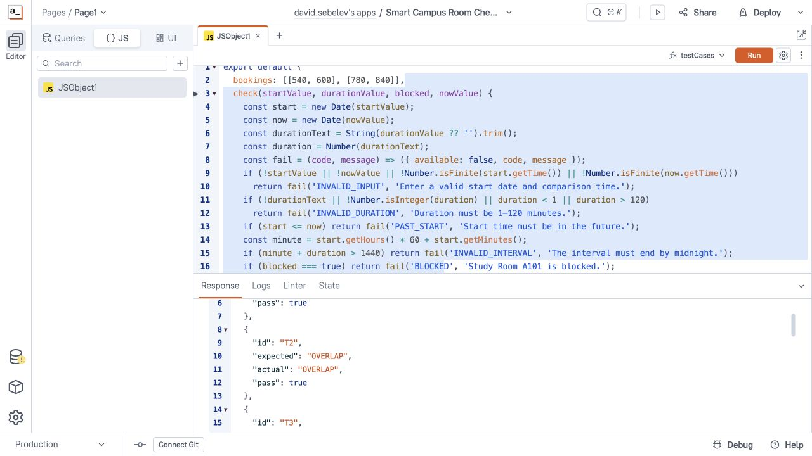

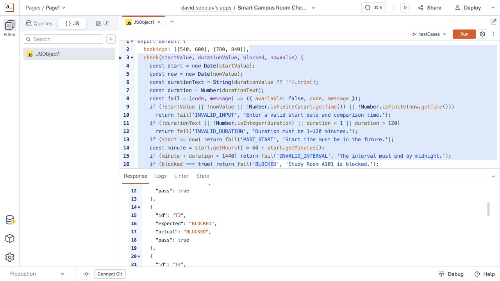

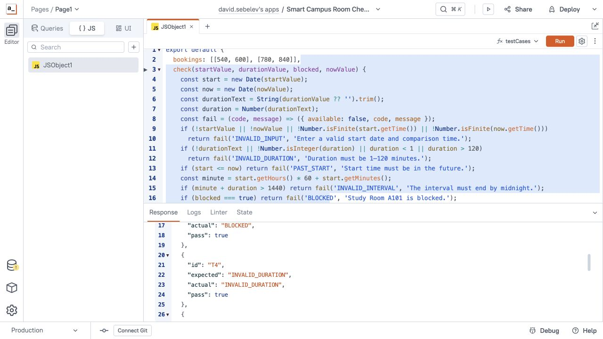

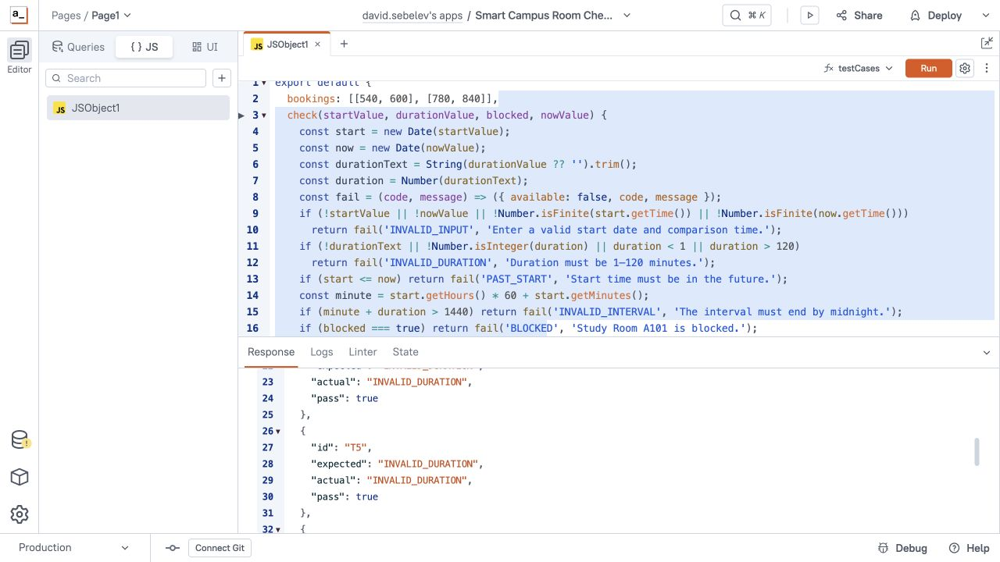

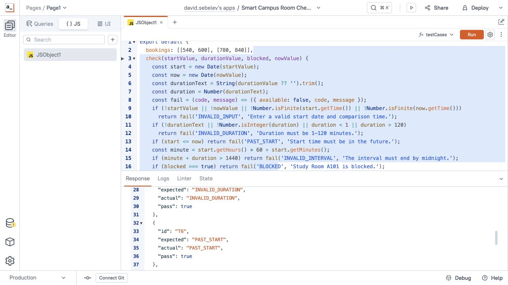

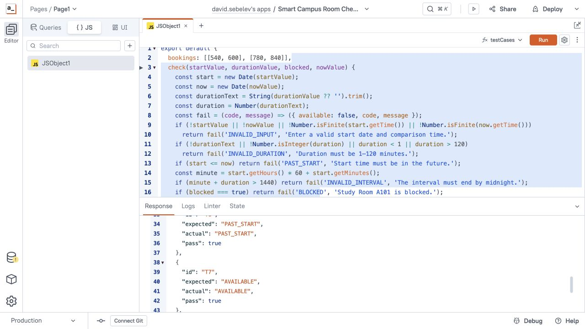

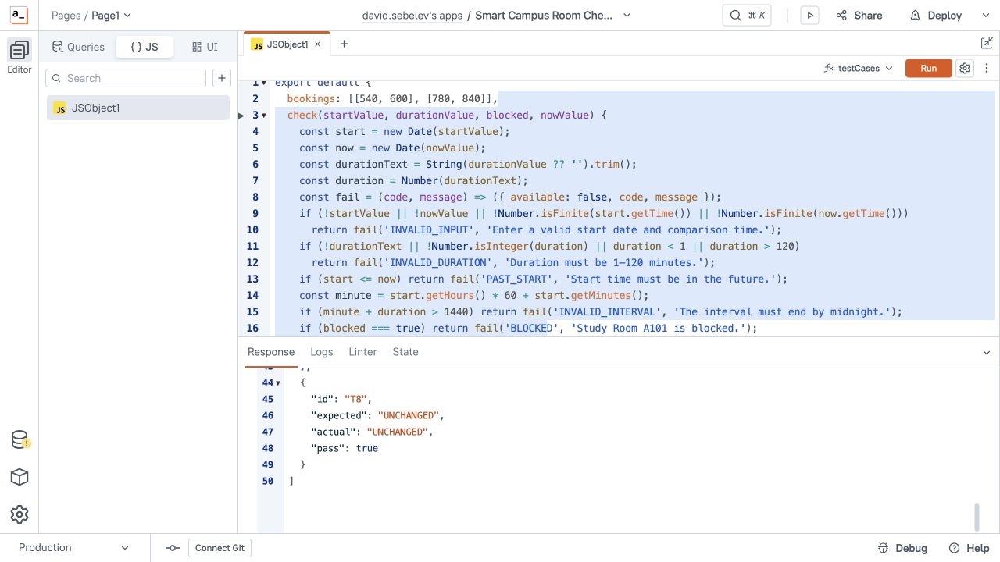

### Deployed Appsmith interface

**Available** — 27 November, 10:30–11:30.

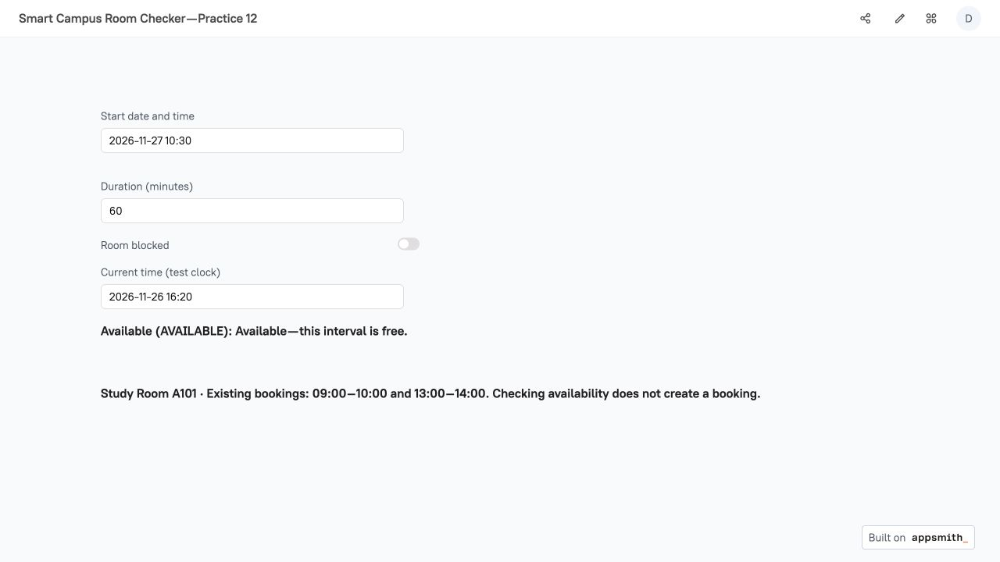

**Overlap** — 27 November, 09:30–10:30 intersects the 09:00–10:00 fixture.

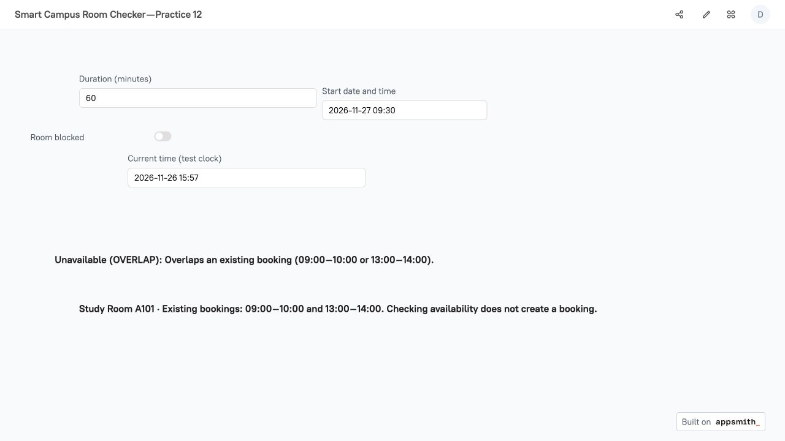

**Blocked** — the room switch is on.

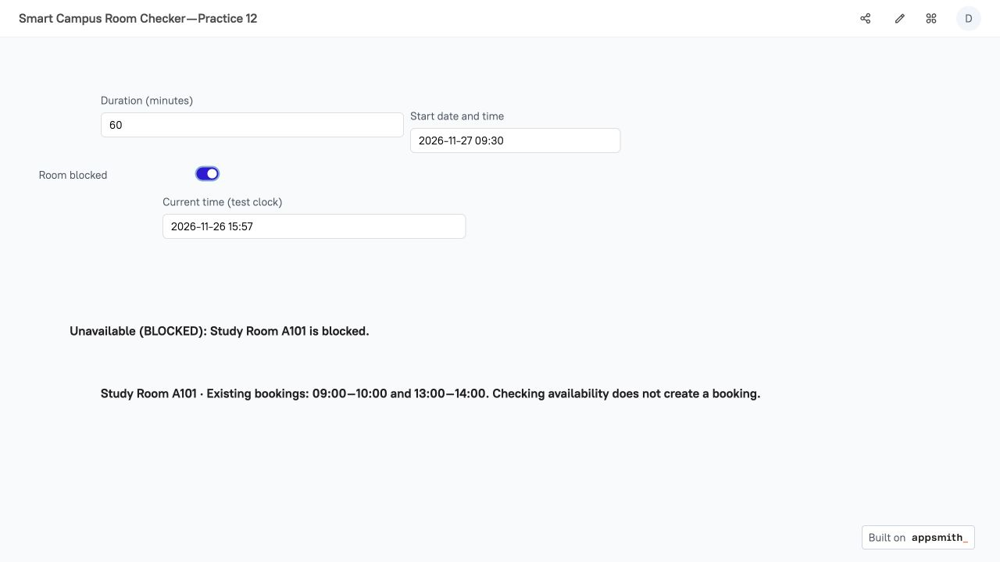

**Invalid duration** — zero minutes.

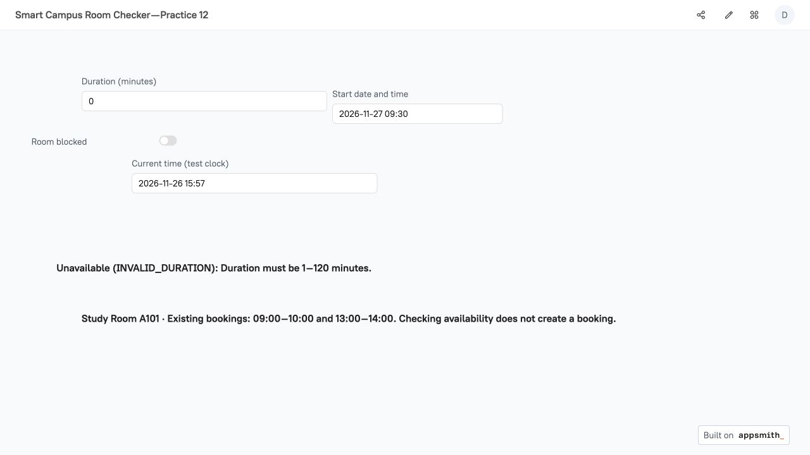

## Platform comparison and recommendation

| Criterion | React and Vite | Appsmith |
|---|---|---|
| Construction | Extended the existing TypeScript/React application | Configured widgets and a JSObject in the browser |
| Validation | Eight shared cases; 121 total tests, lint, typecheck and build | Eight JSObject assertions; four live interface outcomes observed |
| Debugging | Local tests and build errors | JSObject Run response and result text |
| Portability | Source archive and npm scripts | Public application link; export command succeeded, but the downloaded JSON was not captured in the repository |
| Security | No backend, secrets or personal data | No datasource or secrets; application public access is on |
| Measured time or cost | Not measured | Not measured |

I recommend continuing the React version for further Smart Campus work because it retains the existing source and repeatable test suite. Appsmith provided a usable small visual demonstration. I cannot claim that either platform was faster or cheaper, because construction time and hosting costs were not measured.

The React interface accepts a manual clock override for same-day checks; Appsmith accepts a complete comparison timestamp. This is a UI difference, while the fixed test cases have the same expected outputs.

## Security review and limitations

Both demonstrations use fictional booking data and create no reservations. Input is validated for date and duration. React renders result text as text; Appsmith displays fixed result messages. Appsmith's **Make application public** option was enabled on 26 November 2026 ([screenshot](evidence/appsmith-public-access.png)). No user was invited; its invitation dialog warns that invitations may grant access to all applications in the workspace. Anonymous access was not checked from a separate account.

No XSS probe or accessibility audit was completed. Neither demonstration has a trusted server clock, persistent database, concurrent reservation control or server-side authorization. The Appsmith clock initializes at page load and does not continuously tick. These limits matter before either design could serve real bookings.

## AI use and reflection

AI helped interpret the task, adapt the previous React application, configure Appsmith, formulate tests and draft this report. I checked the prior baseline, ran the React validation, ran Appsmith's eight assertions and inspected the deployed interface. The exercise taught me that visual configuration still needs explicit rules, test evidence and permission checks. AI did not measure cost or establish production security.

## Submission status and required checks

The [public repository](https://github.com/muenjmtst/software-engineering-practice-12) contains the React source, report, and Appsmith test screenshots. **Do not submit the ZIP or a OneDrive/WinRAR link.** The Appsmith public option is on; check the link from a signed-out browser before submission. Appsmith displayed “Successfully exported,” but the downloaded JSON was not available to add to the repository. A React running-interface screenshot is still missing because this environment denied the local server and blocked browser navigation to local files. The Appsmith T1–T8 response captures above are genuine. The student supplied class time and model; a separate application version was not recorded.

